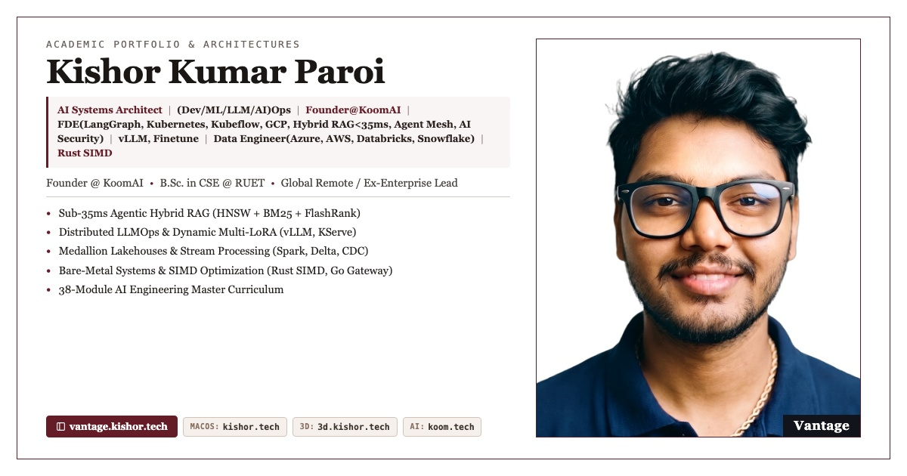

# 🏛️ Kishor Kumar Paroi — Principal AI Systems Architect & Founder @ KoomAI

<div align="center">

[](https://vantage.kishor.tech)
[](https://kishor.tech)
[](https://3d.kishor.tech)
[](https://koom.kishor.tech)
[](https://vantage.kishor.tech/resume.pdf)

<br/>

<a href="#-quick-navigation"><strong>⚡ Jump Directly to Projects & Curriculum Below ↓</strong></a>

<br/>



</div>

---

## ⚡ Quick Navigation

* [🌐 Live Digital Ecosystem](#-live-digital-ecosystem)
* [🚀 Flagship Technical Projects (1 - 11)](#-flagship-technical-projects)
* [🎓 38-Module AI Engineering Journey](#-38-module-ai-engineering-journey)
* [📚 Education & Specialized Certifications](#-education--specialized-certifications)
* [💻 Local Development & Deployment](#-local-development--deployment)
* [📜 License](#-license)

---

## 🌐 Live Digital Ecosystem

| Platform | URL | Architecture Highlights |
| :--- | :--- | :--- |
| **Vintage Academic Portfolio** | **[vantage.kishor.tech](https://vantage.kishor.tech)** | Minimalist academic layout, sub-35ms Hybrid RAG, 38-module bootcamp showcase |
| **macOS Interactive Portfolio** | **[kishor.tech](https://kishor.tech)** | Full desktop OS emulator with draggable windows, dock, and terminal CLI |
| **Interactive 3D WebGL Platform** | **[3d.kishor.tech](https://3d.kishor.tech)** | React 19.2, Rolldown Vite, Tailwind v4, GSAP 3.13 camera choreography |
| **KoomAI Video Intelligence** | **[koom.kishor.tech](https://koom.kishor.tech)** | Sub-120ms WebRTC SVC engine, Electron native capture, 20-agent LangGraph copilot |

---

## 🚀 Flagship Technical Projects

### [1. Zomato AI Lakehouse & Multimodal Dispute Platform](https://github.com/KishorKumarParoi/zomato-analysis)
* **Stack:** Snowflake, PySpark, Delta Lake, dbt Core SCD-2, Debezium CDC, Feast Store, OpenCV, Great Expectations.
* **Impact:** 35M+ orders processed (2.3 GB), warehouse compute costs cut by 42% ($18K/month), delivery dispute fraud neutralized by 68% ($1.2M saved).

### [2. Hybrid Anime Intelligence & Continuous LLMOps Platform](https://github.com/KishorKumarParoi/Hybrid-Anime-Recommender)
* **Stack:** Rust SIMD, Go Gateway, vLLM Multi-LoRA, PyTorch, Kubeflow v2, MLflow, ArgoCD GitOps.
* **Impact:** Vector scoring latency curtailed from 25ms to <0.5ms (50x speedup), NDCG@10 = 0.94, dynamic LoRA multiplexing on single-GPU instances.

### [3. Enterprise AI Security & Production Agentic RAG Platform](https://github.com/KishorKumarParoi/AI_Security_Production_App)
* **Stack:** LangGraph, FastMCP, NVIDIA NeMo Guardrails, FlashRank ONNX, Portkey, Microsoft PyRIT, Qdrant.
* **Impact:** 95%+ prompt injection & jailbreak defense rate, <50ms semantic similarity caching ($8.4K/month saved), 96.4% context precision.

### [4. Smart Manufacturing Industrial AI & Edge MLOps](https://github.com/KishorKumarParoi/smart-manufacturing)
* **Stack:** PyTorch Autoencoders, OpenCV, Rust SIMD, Go Gateway, GKE / K3s, MQTT Broker, SQLite WAL.
* **Impact:** Part escape defect rate reduced by 31% ($420K saved in scrap), offline edge telemetry resilience across 120+ simulated industrial sensors.

### [5. Nexus-AI: Multi-Cloud Lakehouse & Autonomous Agent Mesh](https://github.com/KishorKumarParoi/Nexus_AI)
* **Stack:** Terraform IaC (AWS, Azure, GCP), DuckDB, LangGraph 5-agent supervisor, Go API Gateway (12,000 req/s), Next.js 16.
* **Impact:** Turnaround on complex ad-hoc analytics accelerated by 82%, sub-120ms multi-cloud dashboard queries.

### [6. Advanced AI Chatbot & HITL Financial Gating](https://github.com/KishorKumarParoi/Advanced_AI_Chatbot_Project)
* **Stack:** LangGraph Cyclic State Machines, PostgreSQL Checkpointer, FastMCP, BotShield WAF, Streamlit.
* **Impact:** Fault-tolerant multi-turn thread persistence, dynamic rollbacks, sub-50ms session recovery, and 100% eradication of unauthorized transaction risk.

### [7. Data Agent: Multi-Agent BI & Self-Reflective SQL](https://github.com/KishorKumarParoi/Data-Agent)
* **Stack:** LangGraph Supervisor, Dynamic PostgreSQL Schema Introspection, ReAct ETL, Sandboxed Python.
* **Impact:** 96.2% query classification accuracy, 100% injection interception via LLM security judge, 89% automated query error self-correction.

### [8. Network Security Medallion Lakehouse & Distributed ML](https://github.com/KishorKumarParoi/Advanced_ETL_Project)
* **Stack:** Azure Data Factory (ADF v2), ADLS Gen2, Databricks Spark, MongoDB Atlas, Synapse CETAS, ONNX Runtime.
* **Impact:** 1.4B security log records, 6.2x faster analytical join queries via Z-Order clustering, 98.4% multi-model anomaly detection accuracy.

### [9. AWS SageMaker End-to-End MLOps Pipeline & Governance](https://github.com/KishorKumarParoi/AI-Engineering/tree/main/38_AWS_Sagemaker)
* **Stack:** SageMaker Pipelines (DAG), Managed Spot Instances, Model Registry, DataCapture, KMS CMK.
* **Impact:** 70% model training compute savings, 2,500 req/s sustained throughput with zero cold-starts, full NIST AI RMF compliance.

### [10. Cloud-Native Real-Time MLOps: KServe & ECS Fargate](https://github.com/KishorKumarParoi/AI-Engineering)
* **Stack:** KServe v1beta1, AWS ECS on Fargate, Terraform IaC, Envoy Sidecars, Trivy, Prometheus.
* **Impact:** Dynamic scale-to-zero autoscaling (65% idle spend saved), automated canary traffic routing (90/10 split) with latency rollbacks.

### [11. Core Systems Engineering: Rust Git Engine & POSIX Shell](https://github.com/KishorKumarParoi/codecrafters-git-rust)
* **Stack:** Bare-Metal Rust, SIMD Streaming zlib, Delta Packfiles, POSIX Async Signal Multiplexing.
* **Impact:** Matched C Git performance within 3% with 100% compile-time memory safety, sub-microsecond shell execution latency.

---

## 🎓 38-Module AI Engineering Journey

Codified across the [AI-Engineering](https://github.com/KishorKumarParoi/AI-Engineering) repository:

```
├── Phase I: Foundations & Retrieval
│   ├── 00_Setting_Up_Git ── Git hygiene, pre-commit hooks, secrets scanning
│   ├── 01_Prompt_Engineering ── Few-shot, chain-of-thought, JSON mode
│   ├── 02_Embeddings_and_RAG ── Similarity search, chunking heuristics
│   ├── 03_End-to-End_RAG ── Naive RAG with LangChain & vector databases
│   ├── 04_Production_RAG ── Error handling, latency budgeting, observability
│   ├── 09_Finetuning_Embeddings ── Contrastive loss & Matryoshka embeddings
│   ├── 13_Advanced_Retrieval ── Multi-query expansion & Reciprocal Rank Fusion
│   └── 20_Data_Preprocessing_Embeddings ── High-throughput text tokenization
│
├── Phase II: Agents & State Machines
│   ├── 05_First_Agent_with_LangGraph ── State graphs, conditional edges
│   ├── 06_Multi_Agent_with_LangGraph ── Multi-agent routing & handoffs
│   ├── 24_LangGraph ── Cyclic state machines, checkpointers, state rollbacks
│   ├── 25_Multi_Agents ── Specialized subgraphs, team coordination
│   ├── 26_Agentic_AI ── Self-reflective planning loops & memory
│   ├── 27_Production_Agents ── Resilient tool retries, strict deterministic guards
│   ├── 14_Open_DeepResearch ── Recursive search & synthesis agents
│   └── 17_On_Prem_Agent ── Local air-gapped LLM inference with Ollama & vLLM
│
├── Phase III: Evaluation, Fine-Tuning & Vector Stores
│   ├── 07_Synthetic_Data_Generation ── LangSmith datasets & LLM-as-a-judge
│   ├── 08_Evaluating_RAG_With_Ragas ── Faithfulness, Answer & Context Precision
│   ├── 10_Finetuning_Reasoning_Model ── QLoRA, DeepSeek-R1 style CoT tuning
│   ├── 21_Rag_Qdrant_Pipeline ── HNSW indexing, scalar quantization
│   ├── 22_Rag_Qdrant_Hybrid_Search ── Dense + sparse BM25 fusion
│   ├── 23_Rag_Hybrid_Re_Rank ── Local ONNX FlashRank + Cohere v3.5
│   ├── 18_Inference_Quantization ── AWQ, GPTQ, GGUF 4-bit/8-bit optimizations
│   └── 19_Testing ── Pytest harnesses & CI/CD evaluation testbeds
│
└── Phase IV: Production Systems & Cloud MLOps
    ├── 15_Open_Source_Endpoints ── Self-hosted vLLM / TGI engines
    ├── 16_LLMOps ── Semantic caching, prompt versioning, token budgets
    ├── 28_LLM_Engineering ── Production reliability & cost engineering
    ├── 30_Forward_Deployment_Engineering ── Enterprise customer integration
    ├── 32_Agentic_RAG_Project ── Full-stack enterprise search platform
    ├── 34_Enterprise_Rag_Development ── Enterprise RBAC, audit trails, PII
    ├── 35_Multimodal_Intelligence_System ── Vision-language models & OCR
    ├── 36_Nemotron_Parse_Mistral_OCR ── NVIDIA Nemotron & Mistral OCR
    ├── 37_Astro_Airflow ── Batch data pipelines with Astro CLI
    └── 38_AWS_Sagemaker ── Production SageMaker DAG pipelines & Model Registry
│
└── Phase V: Platform Engineering, FastMCP & HITL Governance
    ├── FastMCP Tool Standardization ── Typed contracts & isolated tool sandbox
    ├── HITL Break-Glass Gates ── Human authorization on critical actions
    ├── Zero-Trust BotShield WAF ── Honeypot traps, sliding rate limits, WAF
    ├── Semantic Intent Caching ── Sub-12ms Cosine similarity gating (<0.15)
    ├── Multi-Cloud Terraform IaC ── Single-command deploy.sh & $0.00 clear.sh
    ├── ArgoCD GitOps Mesh ── Canary deployments across AWS EKS & GCP GKE
    ├── NIST AI RMF Governance ── ISO 27001, SOC 2, HIPAA PII scrubbers
    └── Distributed Observability ── Prometheus, Grafana, OpenTelemetry, Logfire
```

---

## 📚 Education & Specialized Certifications

* **Rajshahi University of Engineering & Technology (RUET)** — B.Sc. in Computer Science & Engineering (Degree with Honors, Merit Rank 483rd Nationwide in Bangladesh).
* **Deep Learning Specialization** — DeepLearning.AI & Stanford (Andrew Ng).
* **Machine Learning Specialization** — Stanford Online & DeepLearning.AI (Andrew Ng).
* **Enterprise Production MLOps & AI Systems Architecture** — Vivian Aranha, Mayank Agarwal, Krish Naik.
* **Distributed Systems & Big Data Engineering** — Arpit Bhayani, Zach Wilson, Hussein Nasser, ByteByteGo.

---

## 💻 Local Development & Deployment

```bash
# Clone the repository
git clone https://github.com/KishorKumarParoi/vantage-portfolio.git
cd vantage-portfolio

# Start a local preview server
python3 -m http.server 8089

# Deploy to Vercel production
vercel --prod
```

---

## 📜 License

Handcrafted by **Kishor Kumar Paroi** &bull; Distributed under the [MIT License](LICENSE).
